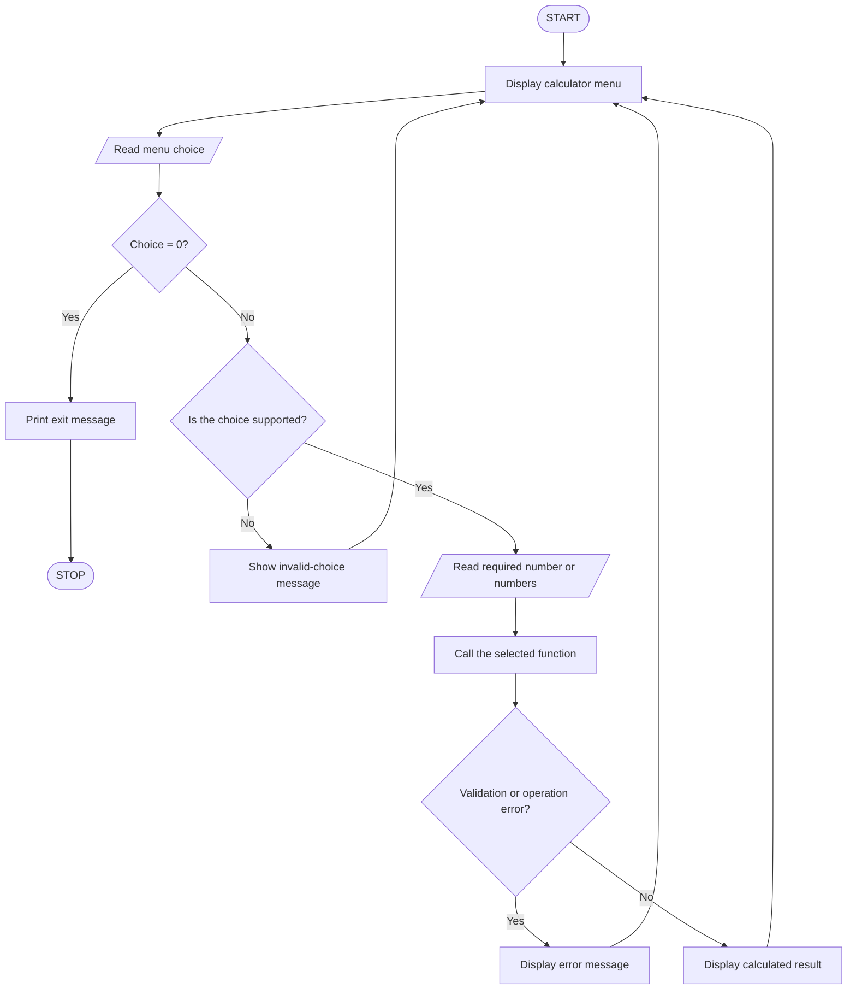
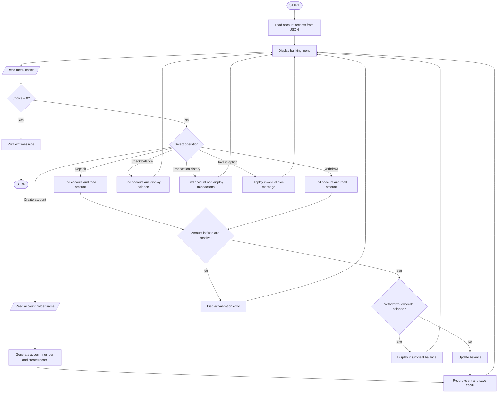

<div align="center">

# `PYTHON LAB`

### Two command-line projects. One standard-library toolkit.

**SCIENTIFIC CALCULATOR** &nbsp; · &nbsp; **BANKING MANAGEMENT SYSTEM**

<kbd>PYTHON 3</kbd> <kbd>FUNCTIONS</kbd> <kbd>MODULES</kbd> <kbd>JSON</kbd> <kbd>CLI</kbd>

<br>

**Author** · [Manas Maity](https://github.com/maitymanas469-png)  
**Student Code** · `BWU/BTS/25/051`

</div>

---

## `00` / Project dashboard

A pair of menu-driven Python applications built to demonstrate how functions divide a program into reusable tasks and how standard-library modules support real features.

| Workstream | What it does | Main concepts |
|:--|:--|:--|
| **01 — Scientific Calculator** | Performs arithmetic, powers, roots, factorials and trigonometry | Functions, parameters, return values, loops, conditionals, `math` |
| **02 — Banking Management System** | Creates accounts, processes deposits and withdrawals, checks balances and lists transactions | Functions, validation, JSON file handling, standard-library modules |

> **Build profile:** No third-party packages, no framework and no external service. Both projects run directly in a Python terminal.

## `01` / Tech stack

| Layer | Technology | Role |
|:--|:--|:--|
| Runtime | **Python 3** | Application language and execution environment |
| Interface | **CLI / Terminal** | Menu-driven user interaction |
| Calculator module | `math` | Square root, factorial, angle conversion and trigonometry |
| Banking modules | `json`, `math`, `datetime`, `pathlib` | Data serialization, numeric validation, timestamps and file paths |
| Persistence | **Local JSON file** | Stores demonstration account data between runs |
| Dependencies | **Python standard library** | No `pip install` required |

<details>
<summary><strong>Module note — what “packages” means here</strong></summary>

The projects use modules supplied with Python's standard library. They are imported directly and do not require a separate installation. The banking project uses `json`, `math`, `datetime` and `pathlib`; the calculator uses `math`.

</details>

## `02` / Repository map

```text
python-pbl-projects/
├── scientific_calculator.py        # Project 01 — calculator logic
├── banking_management_system.py    # Project 02 — banking simulation
├── Python_PBL_Report.pdf           # Printable project report
├── README.md                       # Documentation, algorithms and source
└── .gitignore                      # Keeps local runtime data out of Git
```

## `03` / Quick start

### Requirements

- Python 3 installed and available from the terminal.

Check your Python installation:

```bash
python --version
```

### Run Project 01 — Scientific Calculator

```bash
python scientific_calculator.py
```

### Run Project 02 — Banking Management System

```bash
python banking_management_system.py
```

The banking program creates `bank_accounts.json` in the project directory when the first account is saved. This file is local runtime data and is intentionally excluded from Git.

---

# `PROJECT 01` / Scientific Calculator

<kbd>FUNCTIONS</kbd> <kbd>MATH MODULE</kbd> <kbd>INPUT VALIDATION</kbd>

### Objective

To build a menu-driven scientific calculator by creating reusable user-defined functions and importing Python's `math` module. Each mathematical operation is handled by a dedicated function, keeping the program organized and easy to maintain.

### Feature set

- Basic arithmetic: addition, subtraction, multiplication and division.
- Exponentiation using the power operation.
- Square root and factorial calculations.
- Sine, cosine and tangent using angles entered in degrees.
- Validation for division by zero, negative square roots, invalid factorials and undefined tangent values.

### Functions and module map

| Function / module | Responsibility |
|:--|:--|
| `add(a, b)` | Returns the sum of two values |
| `subtract(a, b)` | Returns the difference |
| `multiply(a, b)` | Returns the product |
| `divide(a, b)` | Divides safely and rejects a zero divisor |
| `power(a, b)` | Calculates exponentiation and rejects complex results |
| `square_root(number)` | Calculates the square root of a non-negative number |
| `factorial(number)` | Calculates factorial for a non-negative whole number |
| `trigonometric(operation, angle_degrees)` | Calculates sine, cosine or tangent after degree-to-radian conversion |
| `format_result(value)` | Formats numeric output for display |
| `show_menu()` / `read_number()` | Displays options and reads numeric input |
| `main()` | Runs the menu loop and dispatches operations |
| `math` | Supplies mathematical functions and numeric checks |

### Execution flow



### Algorithm

1. Start the program and display the calculator menu.
2. Read the user's menu choice.
3. If the choice is `0`, display the exit message and terminate the program.
4. Check whether the selected operation is supported.
5. Read one or two numeric values according to the selected operation.
6. Call the corresponding user-defined function.
7. For trigonometric operations, convert the angle from degrees to radians using `math.radians()`.
8. Validate the input and handle invalid mathematical operations.
9. Display the result or an appropriate error message.
10. Return to the menu and repeat until the user exits.

### Sample terminal output

```text
========== SCIENTIFIC CALCULATOR ==========
1. Addition          6. Square root
2. Subtraction       7. Factorial
3. Multiplication    8. Sine
4. Division          9. Cosine
5. Power            10. Tangent
0. Exit
Enter your choice: 1
Enter first number: 25
Enter second number: 15
Addition result = 40

Enter your choice: 7
Enter a non-negative whole number: 5
Factorial = 120

Enter your choice: 8
Enter angle in degrees: 30
sin(30) = 0.5

Enter your choice: 0
Thank you for using the Scientific Calculator.
```

### Source code

The complete, runnable source is also available in [`scientific_calculator.py`](scientific_calculator.py).

<details>
<summary><strong>▶ Expand full Python source — scientific_calculator.py</strong></summary>

```python
"""Scientific Calculator PBL: demonstrates functions and the math module."""

import math


def add(a, b):
    """Return the sum of two numbers."""
    return a + b


def subtract(a, b):
    """Return the difference of two numbers."""
    return a - b


def multiply(a, b):
    """Return the product of two numbers."""
    return a * b


def divide(a, b):
    """Divide a by b, rejecting division by zero."""
    if b == 0:
        raise ValueError("Division by zero is not allowed.")
    return a / b


def power(a, b):
    """Return a raised to the power b."""
    result = a ** b
    if isinstance(result, complex):
        raise ValueError("Complex-number results are not supported.")
    return result


def square_root(number):
    """Return the square root of a non-negative number."""
    if number < 0:
        raise ValueError("Square root of a negative number is not supported.")
    return math.sqrt(number)


def factorial(number):
    """Return factorial for a non-negative whole number."""
    if number < 0 or not number.is_integer():
        raise ValueError("Factorial requires a non-negative whole number.")
    return math.factorial(int(number))


def trigonometric(operation, angle_degrees):
    """Calculate sine, cosine or tangent; input angle is in degrees."""
    radians = math.radians(angle_degrees)

    if operation == "sin":
        return math.sin(radians)
    if operation == "cos":
        return math.cos(radians)
    if operation == "tan":
        if math.isclose(math.cos(radians), 0.0, abs_tol=1e-12):
            raise ValueError("Tangent is undefined for this angle.")
        return math.tan(radians)

    raise ValueError("Invalid trigonometric operation.")


def format_result(value):
    """Format floating-point output without unnecessary trailing zeroes."""
    return f"{value:.6f}".rstrip("0").rstrip(".")


def show_menu():
    print("\n========== SCIENTIFIC CALCULATOR ==========")
    print("1. Addition          6. Square root")
    print("2. Subtraction       7. Factorial")
    print("3. Multiplication    8. Sine")
    print("4. Division          9. Cosine")
    print("5. Power            10. Tangent")
    print("0. Exit")


def read_number(prompt):
    """Read a number from the keyboard."""
    number = float(input(prompt))
    if not math.isfinite(number):
        raise ValueError("Please enter a finite number.")
    return number


def main():
    """Run the calculator menu until the user chooses Exit."""
    arithmetic_operations = {
        "1": ("Addition", add),
        "2": ("Subtraction", subtract),
        "3": ("Multiplication", multiply),
        "4": ("Division", divide),
        "5": ("Power", power),
    }
    trigonometric_operations = {"8": "sin", "9": "cos", "10": "tan"}

    while True:
        show_menu()
        choice = input("Enter your choice: ").strip()

        if choice == "0":
            print("Thank you for using the Scientific Calculator.")
            break

        try:
            if choice in arithmetic_operations:
                first = read_number("Enter first number: ")
                second = read_number("Enter second number: ")
                label, operation = arithmetic_operations[choice]
                result = operation(first, second)
                print(f"{label} result = {format_result(result)}")

            elif choice == "6":
                number = read_number("Enter a number: ")
                print("Square root =", format_result(square_root(number)))

            elif choice == "7":
                number = read_number("Enter a non-negative whole number: ")
                print("Factorial =", factorial(number))

            elif choice in trigonometric_operations:
                angle = read_number("Enter angle in degrees: ")
                operation = trigonometric_operations[choice]
                result = trigonometric(operation, angle)
                print(f"{operation}({format_result(angle)}) = {format_result(result)}")

            else:
                print("Invalid choice. Please select an option from the menu.")

        except ValueError as error:
            print("Error:", error)


if __name__ == "__main__":
    main()
```

</details>

---

# `PROJECT 02` / Banking Management System

<kbd>FUNCTIONS</kbd> <kbd>STANDARD LIBRARY</kbd> <kbd>JSON STORAGE</kbd>

### Objective

To create a small banking simulation that uses separate functions for account operations and Python standard-library modules for data storage, validation, timestamps and file handling. Account information is saved in a local JSON file so it remains available when the program is run again.

### Feature set

- Create an account with a generated demonstration account number.
- Deposit money and withdraw money from an existing account.
- Check the account holder's name and current balance.
- View transaction history with date, transaction type, amount and resulting balance.
- Persist account data in `bank_accounts.json`.
- Reject missing accounts, invalid amounts and withdrawals above the available balance.

### Modules and functions map

| Module / function | Responsibility |
|:--|:--|
| `json` | Reads and writes account data in JSON format |
| `math` | Validates that entered amounts are finite numbers |
| `datetime` | Adds a timestamp to each transaction |
| `pathlib` | Builds the path to the local JSON data file |
| `load_accounts()` | Loads saved accounts or starts with an empty collection |
| `save_accounts(accounts)` | Writes account data to the JSON file |
| `generate_account_number(accounts)` | Finds an unused demonstration account number |
| `add_transaction(account, type, amount)` | Records a dated transaction and resulting balance |
| `create_account(accounts)` | Creates and saves a new account |
| `find_account(accounts, account_number)` | Searches for an account by its number |
| `deposit(accounts)` / `withdraw(accounts)` | Validates and applies balance changes |
| `check_balance(accounts)` | Displays account name and current balance |
| `show_transactions(accounts)` | Prints the saved transaction history |
| `show_menu()` / `main()` | Displays options and controls the application loop |

### Execution flow



### Algorithm

1. Start the program and load saved records from `bank_accounts.json`. If the file does not exist, use an empty account collection.
2. Display the banking menu and read the user's choice.
3. If the choice is `0`, display the exit message and stop.
4. For **Create Account**, read the account holder's name, generate an unused account number, initialize the balance to zero, record the account-opening event and save the data.
5. For **Deposit**, locate the account and read the amount. Accept only a finite amount greater than zero, update the balance, record the transaction and save the data.
6. For **Withdraw**, locate the account and read the amount. Validate that it is finite and positive, and that the available balance is sufficient. If valid, update the balance, record the transaction and save the data.
7. For **Check Balance**, locate the account and display the account holder's name and current balance.
8. For **Transaction History**, locate the account and display its saved transactions.
9. Display an appropriate message for an invalid menu choice, missing account or invalid transaction.
10. Return to the menu and repeat until the user exits.

### Sample terminal output

```text
========== BANKING MANAGEMENT SYSTEM ==========
1. Create account
2. Deposit money
3. Withdraw money
4. Check balance
5. View transaction history
0. Exit
Enter your choice: 1
Enter account holder name: Shrijit Mukherjee
Account created successfully.
Your account number is: 100001

Enter your choice: 2
Enter account number: 100001
Enter amount to deposit: 5000
Deposit successful. Current balance: Rs. 5000.00

Enter your choice: 3
Enter account number: 100001
Enter amount to withdraw: 1200
Withdrawal successful. Current balance: Rs. 3800.00

Enter your choice: 4
Enter account number: 100001
Account holder: Shrijit Mukherjee
Available balance: Rs. 3800.00

Enter your choice: 0
Thank you for using the Banking Management System.
```

> Transaction timestamps are generated at runtime. The account number shown above is the first number generated when the local data file is empty.

### Source code

The complete, runnable source is also available in [`banking_management_system.py`](banking_management_system.py).

<details>
<summary><strong>▶ Expand full Python source — banking_management_system.py</strong></summary>

```python
"""Banking Management System PBL: demonstrates functions and Python packages.

This is a small educational, command-line simulation. It is not real banking
software and must not be used to store real financial or personal information.
"""

import json
import math
from datetime import datetime
from pathlib import Path

DATA_FILE = Path(__file__).with_name("bank_accounts.json")


def load_accounts():
    """Load account records from the local JSON file, if it exists."""
    if not DATA_FILE.exists():
        return {}

    with DATA_FILE.open("r", encoding="utf-8") as file:
        accounts = json.load(file)

    if not isinstance(accounts, dict):
        raise ValueError("The account data file has an invalid format.")
    return accounts


def save_accounts(accounts):
    """Save records safely by writing a temporary file and replacing the old one."""
    temporary_file = DATA_FILE.with_suffix(".tmp")
    with temporary_file.open("w", encoding="utf-8") as file:
        json.dump(accounts, file, indent=4)
    temporary_file.replace(DATA_FILE)


def generate_account_number(accounts):
    """Generate a simple unique account number for this demonstration."""
    next_number = 100001
    while str(next_number) in accounts:
        next_number += 1
    return str(next_number)


def add_transaction(account, transaction_type, amount):
    """Add a dated transaction entry to an account's transaction history."""
    account["transactions"].append(
        {
            "type": transaction_type,
            "amount": round(amount, 2),
            "balance": round(account["balance"], 2),
            "date": datetime.now().strftime("%Y-%m-%d %H:%M:%S"),
        }
    )


def create_account(accounts):
    """Create an account and return its new account number."""
    name = input("Enter account holder name: ").strip()
    if not name:
        print("Name cannot be empty.")
        return None

    account_number = generate_account_number(accounts)
    accounts[account_number] = {
        "name": name,
        "balance": 0.0,
        "transactions": [],
    }
    add_transaction(accounts[account_number], "Account opened", 0.0)
    save_accounts(accounts)

    print("Account created successfully.")
    print("Your account number is:", account_number)
    return account_number


def find_account(accounts, account_number):
    """Return an account if the supplied account number exists."""
    account = accounts.get(account_number)
    if account is None:
        print("Account not found. Please check the account number.")
    return account


def deposit(accounts):
    """Deposit a positive amount into an existing account."""
    account_number = input("Enter account number: ").strip()
    account = find_account(accounts, account_number)
    if account is None:
        return

    try:
        amount = float(input("Enter amount to deposit: "))
    except ValueError:
        print("Please enter a valid numeric amount.")
        return

    if not math.isfinite(amount) or amount <= 0:
        print("Enter a finite amount greater than zero.")
        return

    account["balance"] = round(account["balance"] + amount, 2)
    add_transaction(account, "Deposit", amount)
    save_accounts(accounts)
    print(f"Deposit successful. Current balance: Rs. {account['balance']:.2f}")


def withdraw(accounts):
    """Withdraw money if the amount is positive and funds are sufficient."""
    account_number = input("Enter account number: ").strip()
    account = find_account(accounts, account_number)
    if account is None:
        return

    try:
        amount = float(input("Enter amount to withdraw: "))
    except ValueError:
        print("Please enter a valid numeric amount.")
        return

    if not math.isfinite(amount) or amount <= 0:
        print("Enter a finite amount greater than zero.")
    elif amount > account["balance"]:
        print("Insufficient balance. Transaction cancelled.")
    else:
        account["balance"] = round(account["balance"] - amount, 2)
        add_transaction(account, "Withdrawal", amount)
        save_accounts(accounts)
        print(f"Withdrawal successful. Current balance: Rs. {account['balance']:.2f}")


def check_balance(accounts):
    """Display the holder name and current account balance."""
    account_number = input("Enter account number: ").strip()
    account = find_account(accounts, account_number)
    if account is not None:
        print("Account holder:", account["name"])
        print(f"Available balance: Rs. {account['balance']:.2f}")


def show_transactions(accounts):
    """Display all recorded transactions for an account."""
    account_number = input("Enter account number: ").strip()
    account = find_account(accounts, account_number)
    if account is None:
        return

    print(f"\nTransaction history for {account['name']} ({account_number})")
    if not account["transactions"]:
        print("No transactions recorded.")
        return

    for item in account["transactions"]:
        print(
            f"{item['date']} | {item['type']} | "
            f"Rs. {item['amount']:.2f} | Balance: Rs. {item['balance']:.2f}"
        )


def show_menu():
    print("\n========== BANKING MANAGEMENT SYSTEM ==========")
    print("1. Create account")
    print("2. Deposit money")
    print("3. Withdraw money")
    print("4. Check balance")
    print("5. View transaction history")
    print("0. Exit")


def main():
    """Load data and run the banking menu."""
    try:
        accounts = load_accounts()
    except (OSError, json.JSONDecodeError, ValueError) as error:
        print("Could not load account data:", error)
        print("Please check the bank_accounts.json file before running again.")
        return

    actions = {
        "1": create_account,
        "2": deposit,
        "3": withdraw,
        "4": check_balance,
        "5": show_transactions,
    }

    while True:
        show_menu()
        choice = input("Enter your choice: ").strip()

        if choice == "0":
            print("Thank you for using the Banking Management System.")
            break
        elif choice in actions:
            try:
                actions[choice](accounts)
            except OSError as error:
                print("Could not save account data:", error)
        else:
            print("Invalid choice. Please select an option from the menu.")


if __name__ == "__main__":
    main()
```

</details>

---

## `04` / Learning outcomes

After completing these projects, the following Python concepts are demonstrated:

- Defining and calling reusable functions.
- Passing arguments and returning values.
- Using conditionals, loops and dictionaries to control program flow.
- Importing and using standard-library modules.
- Validating user input and handling common errors.
- Reading and writing structured data with JSON.
- Organizing a console application into smaller, understandable tasks.

## `05` / Scope & disclaimer

These applications are made for an academic Python PBL demonstration. The banking system is a local educational simulation only; it does not provide authentication, encryption, secure financial records or real banking services. Do not enter real financial or personal information.

---

<div align="center">

**END OF DOCUMENTATION**  
`PYTHON / PBL-LAB` · `FUNCTIONS` · `MODULES` · `FILE HANDLING`

**Author:** [Manas Maity](https://github.com/maitymanas469-png)

</div>
